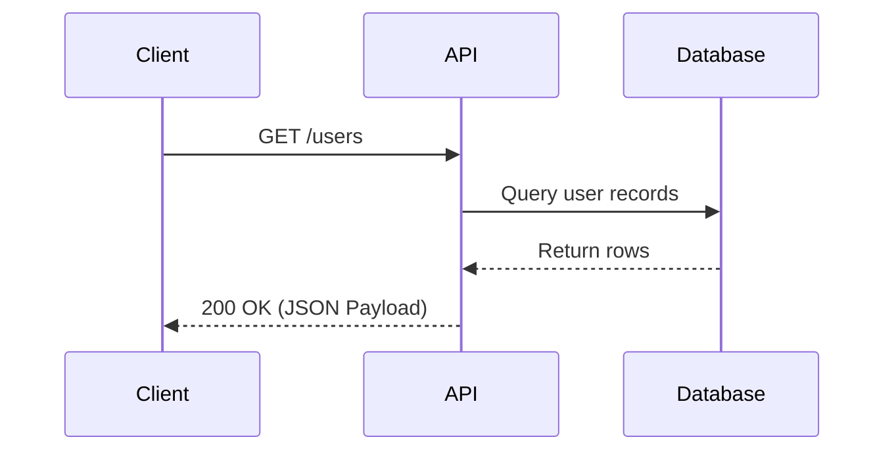

# How The Property Search Parser Works

## Problem
People type searches like this:
"Show me 3-bedroom condos in Irvine under $1.5M with a pool"
The database can't read this search It only understands structured filters: L_City = 'Irvine', L_Keyword2 >= 3, L_SystemPrice <= 1500000, and so on. The parser translates the sentence into those filters.

## How Openclaw Uses This Parser

